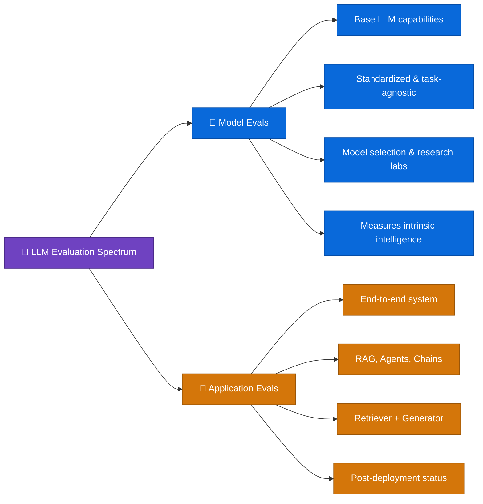
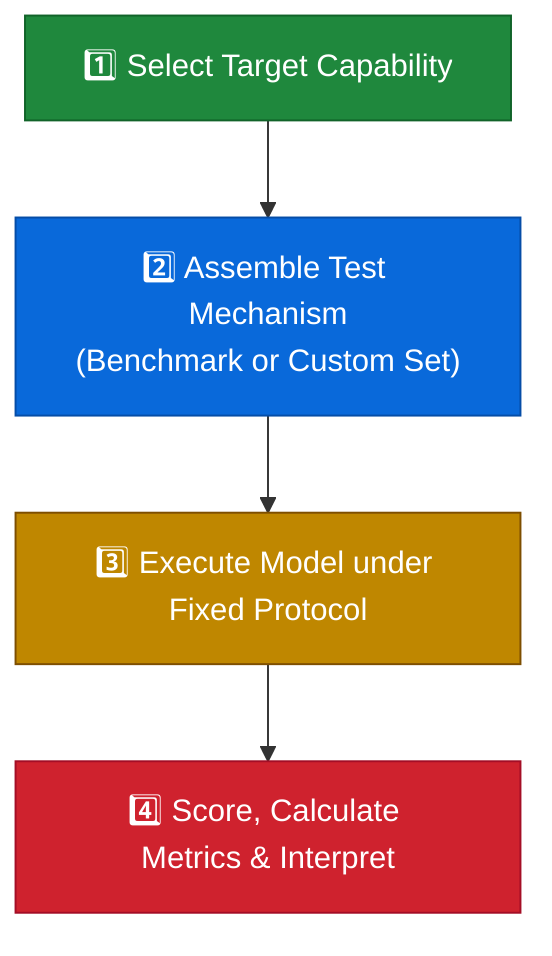
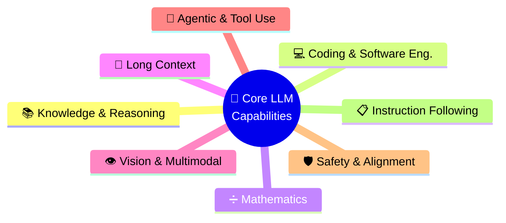
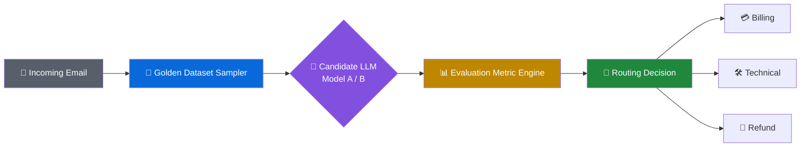
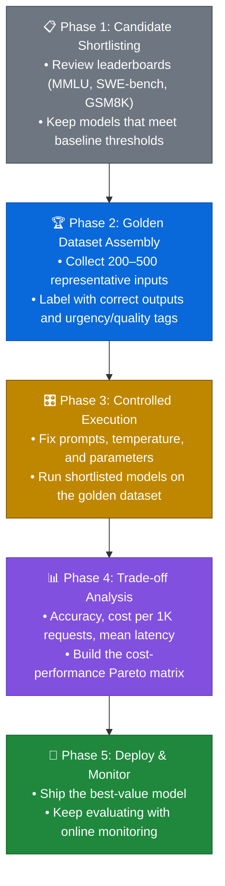

<div align="center">

# 🧠 LLM Model Evals & Capabilities

### CampusX · LLM Evaluation Playlist — Study Notes


</div>

---

## 📑 Table of Contents

1. [Overview](#-overview)
2. [Topics Covered](#-topics-covered)
3. [Context & Architectural Overview](#1--context--architectural-overview)
4. [Why AI Engineers Need Model Evals](#2--why-ai-engineers-need-model-evals)
5. [The 4-Step Model Evaluation Process](#3--the-4-step-model-evaluation-process)
6. [Benchmarks vs. Custom Evaluation Sets](#4--benchmarks-vs-custom-evaluation-sets)
7. [The 8 Core LLM Capability Domains](#5--the-8-core-llm-capability-domains)
8. [Case Study: Zomato Email Routing](#-case-study-zomato-email-routing-system)
9. [CLI & Tool Workflows](#-command-line--technical-tool-workflows)
10. [Errors & Troubleshooting](#-errors--troubleshooting)
11. [Comparisons](#-comparisons)
12. [Best Practices / Common Mistakes](#-best-practices--common-mistakes)
13. [End-to-End Flow](#-end-to-end-flow)
14. [Key Takeaways](#-key-takeaways)
15. [Quick Revision](#-quick-revision)
16. [Glossary](#-glossary)

---

## 📌 Overview

This document summarizes the lecture on **LLM Model Evals & Capabilities** from the CampusX LLM Evaluation playlist. The session moves the course from a big-picture overview of LLM evaluation into the technical details.

Earlier lectures covered post-deployment online monitoring and **application-level evaluations** (RAG and autonomous agents). This session focuses on **Model Evaluations (Model Evals)**: the methods used to measure, benchmark, and compare what the underlying LLMs can do on their own.

> [!NOTE]
> The lecture argues that **AI engineers**, not just frontier research labs, need to know model evals well. They are what you use to decide which model to pick, whether to take a version upgrade, whether a model is safe enough, and whether to self-host an open-source model or pay for a proprietary API.

---

## 🗂️ Topics Covered

<details>
<summary><b>🔵 Course Context & Series Recap</b></summary>

- How Model Evals differ from Application Evals
- Offline evaluation pipelines vs. post-deployment online evaluation
</details>

<details>
<summary><b>🟢 Why AI Engineers Need Model Evals</b></summary>

- Choosing between models and comparing them head to head
- Checking model upgrades and testing for regressions
- Auditing for safety, hallucinations, and jailbreaks
- Deciding between proprietary APIs and self-hosted open-source models
</details>

<details>
<summary><b>🟡 Formal Definition & The 4-Step Process</b></summary>

- Core definition of a Model Eval
- Step 1: Choose the capability to test
- Step 2: Build the test dataset or mechanism
- Step 3: Run under a fixed protocol
- Step 4: Score and interpret the metrics
</details>

<details>
<summary><b>🟠 Public Benchmarks vs. Custom Golden Datasets</b></summary>

- What standardized benchmarks are and what they are good for
- Purpose and structure of domain-specific golden evaluation sets
- Zomato case study: Model A (top-tier) vs. Model B (lightweight)
</details>

<details>
<summary><b>🔴 The 8 Core LLM Capability Domains</b></summary>

- Knowledge & Reasoning · Coding · Mathematics · Long Context
- Vision & Multimodal · Agentic & Tool Use · Safety & Alignment · Instruction Following
</details>

<details>
<summary><b>🟣 Why Theory Comes Before Practice</b></summary>

- A theoretical foundation lets you look at an engineering problem from more than one angle and get more out of the hands-on work
</details>

---

## 📖 Detailed Notes

### 1. 🏗️ Context & Architectural Overview

In production LLM engineering, evaluations fall into **two types**:

| | 🔷 **Model Evals** | 🔶 **Application Evals** |
|---|---|---|
| **What it measures** | What the base LLM can do on its own: capabilities, safety limits, operating behaviour | How the whole LLM-powered system performs end to end |
| **Example** | MMLU score, coding pass rate | Retriever relevance, generator faithfulness, and answer quality in a RAG pipeline |



> [!TIP]
> **Frontier labs** (OpenAI, Anthropic, Google) use model evals to guide training, refine architectures, and find capability gaps during pre-training and fine-tuning.
> **AI engineers** use them to pick and tune the model that acts as the "brain" of their product.

---

### 2. 🎯 Why AI Engineers Need Model Evals

When you build enterprise applications, you can't go on gut feeling or vendor marketing. Model evals give you numbers to back up **four key engineering decisions**:

#### 🅰️ Model Selection & Comparison
When choosing between providers (e.g., **OpenAI GPT-4o** vs. **Anthropic Claude**), you need to bring data to the architecture review, not opinions. Model evals show *why* one model beats another on your workload.

#### 🅱️ Upgrades & Regression Testing
When a provider ships a new version (e.g., moving from **Claude Opus** to a newer model such as **Fable**), check whether it actually does better on *your* tasks, or quietly does worse, **before** you put it in production.

#### 🅲 Safety, Reliability & Risk Auditing
Model evals put numbers on operational risks such as hallucination rate, jailbreak susceptibility, adversarial attacks, and toxic output, so you can show the model meets your company's governance rules.

#### 🅳 Proprietary API vs. Open-Source Hosting

| Option | ✅ Pros | ❌ Cons |
|---|---|---|
| **Proprietary APIs** | High capability, no infrastructure to run | Higher per-token cost, vendor lock-in |
| **Self-hosted open source** (DeepSeek, Qwen, Llama via Hugging Face) | Data privacy, cheaper at high volume | You maintain the infrastructure; may be less capable |

> [!IMPORTANT]
> Model evals give you the **performance-vs-cost matrix** you need to decide whether an open-source model is accurate enough to replace an expensive proprietary API.

---

### 3. 🔄 The 4-Step Model Evaluation Process

> [!NOTE]
> **Definition:** *Model evaluation is a systematic process of measuring an underlying model's capabilities, behavior, reliability, and operational characteristics under controlled conditions.*

LLMs are general-purpose, so **no single number** captures how good one is (there's no "IQ score" for LLMs). Every model eval follows the same four steps:



| Step | Name | What happens |
|:---:|---|---|
| 🟢 **1** | **Select Target Capability** | Pick exactly what you're testing (math reasoning, Python code generation, jailbreak resistance, instruction following) |
| 🔵 **2** | **Assemble Test Mechanism** | Use an established public benchmark or build your own internal eval dataset |
| 🟡 **3** | **Execute Under Fixed Protocol** | Keep the prompt template, system instructions, `temperature`, `top_p`, and context window **identical** across models so results are reproducible |
| 🔴 **4** | **Score & Interpret** | Parse the outputs, score them against ground truth or metrics, and analyse the results |

---

### 4. ⚖️ Benchmarks vs. Custom Evaluation Sets

| 🌍 **Standardized Public Benchmarks** | 🏆 **Custom Evaluation Sets (Golden Datasets)** |
|---|---|
| Shared, public test suites: **MMLU**, **SWE-bench**, **GSM8K** | Private test sets built from **curated production data** |
| Every model takes the **same test**, which makes leaderboards possible | Usually **200–500 human-labeled** real inputs |
| Good for general baseline comparisons | Measures performance on the **exact kind of data** you see in production |

---

### 5. 🧩 The 8 Core LLM Capability Domains

The lecture groups LLM evaluations into **eight capability domains**. Each benchmark is built to test one or more of them.



---

#### 📚 1. Knowledge & Reasoning

| | |
|---|---|
| **Scope** | **Factual recall** (what the model learned in pre-training, across subjects) plus **multi-step reasoning** (combining separate facts to reach a correct conclusion) |
| **Benchmark** | **MMLU**: 57 academic and professional subjects (biology, physics, history, law, …) |
| **Example test** | Summarize human history from the Big Bang to today, then explain why present-day societies are structured the way they are by following the chain of causes |
| **Frontier lab focus** | Main stand-in for *general intelligence* |
| **Production use** | Research chatbots, paper synthesis, complex customer support, expert assistants (legal, medical, education) |

---

#### 💻 2. Coding & Software Engineering

**Scope:** Whether the model can write code that runs, is syntactically correct, and does the right thing, across the whole development workflow.

```diff
+ Function-level code generation   → Write a self-contained function from a plain-English spec
+ Unit test generation             → Write thorough unit test suites
+ Iterative debugging              → Fix code using execution error traces
+ Codebase bug fixing              → Find and fix bugs in multi-file repositories
+ Long-horizon refactoring         → Refactor the architecture of large projects
+ CLI execution & env management   → Run terminal commands, install packages, configure servers
+ API & function calling           → Build valid API payloads and call tools
```

> [!TIP]
> 💰 **Why it matters:** Coding has huge commercial value. Coding assistants like **Cursor** have reached multi-billion-dollar valuations.

---

#### ➗ 3. Mathematics

**Scope:** Getting symbolic and numerical reasoning right, step by step.

| Level | Description |
|---|---|
| 🟢 **Grade School** | Basic algebra and word problems (7th–8th grade) |
| 🟡 **Competition** | Creative problem-solving (Olympiad level) |
| 🟠 **Undergraduate** | Advanced calculus, linear algebra, abstract math |
| 🔴 **Research** | Unsolved or open-ended problems |

**Production use:** Scientific computing, quantitative finance, engineering simulations, data analysis pipelines.

---

#### 📜 4. Long Context Handling

**Scope:** How well the model finds, combines, and reasons over **very long inputs** (100K to 1M+ tokens).

- 🪡 **Needle in a Haystack:** Find one isolated fact buried deep inside a huge document
- 📉 **Context degradation:** Accuracy drops as the conversation gets longer (often called *"lost in the middle"*)
- 🗃️ **Entity tracking & codebase context:** Keep track of entities or the full repository state across many turns

---

#### 👁️ 5. Vision & Multimodal Understanding

**Scope:** Whether the model can understand and reason about **images, diagrams, and video frames** together with text.

**Production use:** Suggesting recipes from a photo of your fridge, extracting data from document images, visual navigation.

---

#### 🤖 6. Agentic & Tool Use

**Scope:** Whether the model can carry out **multi-step workflows on its own** by choosing and using external tools, instead of only returning text.

**Key actions:** 🌐 Web browsing · 🔧 Calling tools and APIs · 🗄️ Querying databases · 🖥️ Automating the desktop / OS

---

#### 🛡️ 7. Safety & Alignment

**Scope:** Whether the model behaves responsibly and reliably, both normally and when someone is actively trying to break it.

| Vector | What is tested |
|---|---|
| 🚫 **Harmful content prevention** | Refuses requests for dangerous, violent, or illegal instructions |
| 🧱 **Adversarial robustness** | Resists prompt injection and jailbreaks |
| ⚖️ **Truthfulness vs. sycophancy** | Tells the truth instead of flattering the user or agreeing with wrong statements *(the lecture's example: Claude rated more truthful, ChatGPT more prone to sycophantic agreement)* |
| 🔐 **Cybersecurity capability auditing** | Dual-use skills (cryptography, reverse engineering, finding vulnerabilities). Frontier models such as **Claude Mythos / Fable** can find real software security flaws, so guardrails need to block exploit generation |

---

#### 📋 8. Instruction Following

**Scope:** How exactly the model sticks to explicit formatting, structure, and style instructions.

- ✅ Output format (strict **JSON schema**, bullet lists)
- ✅ Length limits (e.g., **< 200 words**)
- ✅ Persona and tone
- ✅ **Asking clarifying questions** when the prompt is ambiguous

---

## 🍔 Case Study: Zomato Email Routing System

> [!IMPORTANT]
> This case study shows why **public benchmarks alone aren't enough** for real production decisions.

### 🏛️ System Architecture

The system reads incoming customer emails, works out how urgent each one is, and routes it to **Billing**, **Technical**, or **Refund**.



### 🥊 Model Candidates

| | 🅰️ **Model A** | 🅱️ **Model B** |
|---|---|---|
| **Type** | Large, top-of-leaderboard frontier model (e.g., Claude Opus) | Compact, lightweight model (e.g., small Qwen / MiniMax) |
| **Benchmark rank** | Near the top in every category | Middle of the table |
| **API cost** | 🔴 **$15.00** / 1M tokens | 🟢 **$0.50** / 1M tokens |

### 🧪 Evaluation Protocol

Instead of relying on MMLU or SWE-bench, the team built a **golden dataset of 200–500 past customer emails**, each labeled by domain experts with the correct category and urgency score. Both models ran on this dataset with **identical prompts**.

### 📊 Results

| Metric | 🅰️ Model A | 🅱️ Model B | Impact |
|---|:---:|:---:|---|
| **Category accuracy** | 94.0% | 91.0% | A leads by only **3.0 pp** |
| **Urgency detection** | 88.0% | 87.0% | Only **1.0 pp** apart |
| **Cost / 1,000 emails** | 🔴 $6.00 | 🟢 < $0.20 | **30× cheaper** |
| **Mean latency** | 🔴 4.1 s | 🟢 0.9 s | **4.5× faster** |

```diff
- Leaderboard-only decision  → Deploy Model A (expensive, slow, ~3 pp more accurate)
+ Golden-dataset decision    → Deploy Model B (95%+ cheaper, 4.5× faster, almost as accurate)
```

> [!TIP]
> **Why they chose Model B:** On this email classification task it is almost as accurate as Model A, **costs over 95% less per token**, and cuts latency from **4.1 s to 0.9 s** per request.

---

## 💻 Command Line & Technical Tool Workflows

Coding and agentic evals test whether an LLM can run terminal commands **in the right order** to set up environments and fix repositories.

```bash
# ═══════════════════════════════════════════════════════════
#  Example evaluation sequence: CLI & package management
# ═══════════════════════════════════════════════════════════

# 1️⃣  Set up the environment
python3 -m venv /workspace/eval_env && source /workspace/eval_env/bin/activate

# 2️⃣  Install dependencies
pip install --upgrade pip setuptools
pip install torch transformers datasets

# 3️⃣  Inspect the codebase and check the bug
rg -n "def parse_payload" /workspace/src/
pytest /workspace/tests/test_parser.py
```

---

## 🚨 Errors & Troubleshooting

> [!WARNING]
> **Over-reliance on public benchmarks**
> Ranking first on MMLU does **not** mean the model will be best at your domain task. Benchmarks measure broad general ability, not your company's data.

> [!WARNING]
> **Benchmark data contamination**
> A model may have seen benchmark questions during pre-training. That **inflates** its scores, and the advantage disappears on new production data.

> [!CAUTION]
> **Uncontrolled prompt & parameter variability**
> Testing Model A at `temperature=0.7` and Model B at `temperature=0.0`, or wrapping them in different system prompts, makes the comparison **unfair and invalid**. Fix every setting before comparing.

> [!CAUTION]
> **Sycophancy that looks like alignment**
> A model that agrees with users' wrong statements can pass simple safety filters and still fail a strict truthfulness audit.

| 📉 Benchmark over-reliance | 🎛️ Prompt template mismatches |
|---|---|
| Benchmark score ≠ production accuracy | System prompts not kept the same |
| Data contamination in pre-training | Different `temperature` / `top_p` |
| Ignores latency and cost | Skewed benchmark results |

---

## 🔍 Comparisons

### 1️⃣ Model Evals vs. Application Evals

| Dimension | 🔷 Model Evals | 🔶 Application Evals |
|---|---|---|
| **Target** | The base LLM's own capabilities | The whole system (RAG, agents, chains) |
| **Used by** | AI research labs & system architects | AI application engineers & product teams |
| **Test data** | Standardized tasks, synthetic sets, benchmarks | Real user inputs, golden datasets, live traces |
| **Key metrics** | MMLU, Pass@1 coding accuracy, reasoning depth | Context recall, answer faithfulness, user satisfaction |

### 2️⃣ Public Benchmarks vs. Custom Golden Datasets

| Dimension | 🌍 Public Benchmarks | 🏆 Golden Datasets |
|---|---|---|
| **Scope** | Broad, many domains, not tied to a task | Narrow, specific to your task and domain |
| **Cost** | 🟢 Free and public | 🟡 Needs curation and expert labeling (200–500 samples) |
| **Main value** | General ranking and first-pass filtering | Accurate picture of production accuracy, cost, and latency |
| **Risk** | 🔴 Contamination; may not match business metrics | 🟡 Must be kept up to date as production data changes |

### 3️⃣ Proprietary APIs vs. Self-Hosted Open Source

| Dimension | ☁️ Proprietary API | 🏠 Self-Hosted Open Source |
|---|---|---|
| **Setup effort** | 🟢 None; just call the API | 🔴 High: GPU servers, serving wrappers, HF pipelines |
| **Data privacy** | 🟡 Depends on the vendor's data agreement | 🟢 Data never leaves your own cloud |
| **Cost at scale** | 🔴 Pay per token, grows linearly | 🟢 Fixed infrastructure cost, cheap at high volume |

---

## ✅ Best Practices / ❌ Common Mistakes

### ✅ Best Practices

```diff
+ Combine benchmarks with custom evals  → Benchmarks to shortlist, golden datasets for the final pick
+ Fix execution parameters              → Same temperature, prompts, seeds, and limits for every model
+ Measure cost & latency with accuracy  → Plot a Pareto frontier: accuracy vs. cost vs. latency
+ Test for sycophancy                   → Feed wrong or leading statements; the model should correct you
```

### ❌ Common Mistakes

```diff
- Picking models from leaderboards only  → Paying for #1 when a cheaper model does your task just as well
- Not versioning the test set            → Golden datasets not version-controlled as new edge cases appear
- Ignoring long-context degradation      → Trusting a "1M token" window without testing retrieval when it's nearly full
```

---

## 🔁 End-to-End Flow



---

## 🔑 Key Takeaways

> [!IMPORTANT]
> 1. **Model evals** measure what an LLM can do on its own under controlled conditions. They are the basis for architecture decisions in AI engineering.
> 2. **Public benchmarks** give a general signal; **custom golden datasets** are essential for tuning production cost, speed, and task accuracy.
> 3. LLM evaluation covers **8 core capabilities**: Knowledge & Reasoning, Coding, Mathematics, Long Context, Vision, Agentic Tool Use, Safety & Alignment, and Instruction Following.
> 4. The best model balances **accuracy against cost and latency**. A higher benchmark score doesn't automatically justify a much higher bill.

---

## ⚡ Quick Revision

| 🏷️ Term | 💡 One-liner |
|---|---|
| **Model Eval vs. App Eval** | Model Eval tests the LLM itself; App Eval tests the whole system (like RAG) |
| **4 steps of Model Eval** | 🟢 Target capability → 🔵 Pick test → 🟡 Run protocol → 🔴 Score & interpret |
| **Golden dataset** | 200–500 real, expert-labeled inputs for testing your own task |
| **Needle in a Haystack** | Can the LLM find one fact buried in a 100K+ token prompt? |
| **Sycophancy** | The LLM agrees with a wrong user statement instead of telling the truth |

---

## 📚 Glossary

<details open>
<summary><b>Click to expand / collapse</b></summary>

| Term | Definition |
|---|---|
| 🧪 **Model Evaluation (Model Eval)** | Systematically measuring an LLM's own capabilities, safety limits, and operating metrics under controlled test conditions |
| 📏 **Benchmark** | A standard, public test dataset used across the industry to compare models on equal terms (MMLU, GSM8K, SWE-bench) |
| 🏆 **Golden Dataset** | A high-quality, domain-specific test set built from real application data with verified correct labels |
| 📚 **MMLU** | *Massive Multitask Language Understanding*: tests knowledge and reasoning across 57 academic and professional subjects |
| 💻 **SWE-bench** | Tests whether an LLM can resolve real GitHub issues in complex codebases |
| ➗ **GSM8K** | Grade-school math word problems that test multi-step numerical reasoning |
| 🪡 **Needle in a Haystack (NIAH)** | Tests whether an LLM can find one specific piece of information hidden in a very long context |
| 🔓 **Prompt Injection / Jailbreak** | Attacks that try to get around an LLM's safety guardrails to make it produce forbidden or harmful output |
| 🙇 **Sycophancy** | An LLM's tendency to agree with the user's beliefs or mistakes instead of giving accurate, neutral facts |
| 🏛️ **Frontier Labs** | Leading AI research organizations (OpenAI, Anthropic, Google DeepMind) building state-of-the-art foundation models |

</details>

---

<div align="center">

**⭐ If these notes helped you, consider starring the repo! ⭐**


</div>
